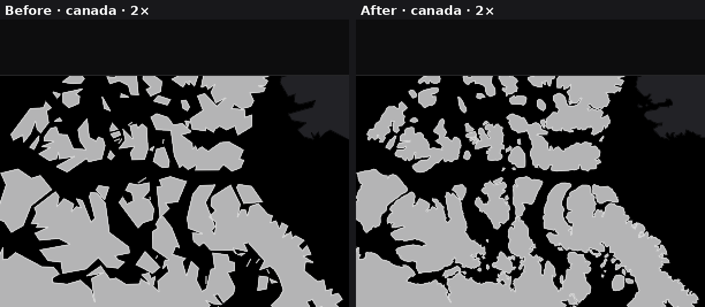
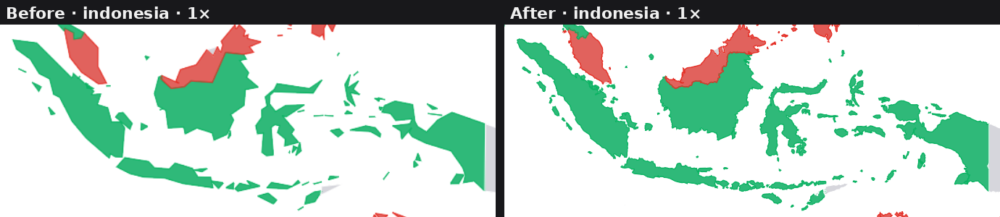

# Presnosť tvarov krajín na mapách (2026-11-27)

Merané nástrojom `tools/shape-fidelity.cjs`: o koľko pixelov sa vykreslený obrys krajiny odchyľuje od zdrojových tvarov (`public/data/countries.<hash>.topo.json`). **Prah: najviac 1 px pri každej krajine, veľkosti okna a hustote pixelov (DPR).** Metodika je na konci.

## Zhrnutie

| | Úvodná mapa | Mapa zápasu |
|---|---|---|
| **Pred** (`main`: tolerancia 1,5, plátno najviac 4096 px) | 2,7–7,5 px, neprejde ani jedna zo 14 | 0,9–2,4 px (rovnaké ako #6) |
| **PR #6** (predvolená tolerancia 0,375) | 1,0–6,6 px, prejdú 2 zo 14 | 0,9–2,4 px, prejdú 3 zo 14 |
| **Teraz** (0,125 / DPR, plátno do 8192 px) | **0,57–0,80 px, prejde všetkých 14** | **0,57–0,80 px, prejde všetkých 14** |

(14 = šesť veľkostí okna od 1280 × 720 po 3840 × 2160 pri DPR 1 a 2, plus telefón 390 × 844 pri DPR 2 a 3. Rozsah = najhoršia krajina pri najlepšej a najhoršej veľkosti okna. Úplne presné vykreslenie má 0,50 px, pozri metodiku.)

## Príčina

1. **Zjednodušenie tvarov pri rezaní na dlaždice.** MapLibre zjednodušuje tvary (Douglas–Peucker) s toleranciou v pixeloch dlaždice: predvolene 0,375, úvodná mapa mala 1,5. Chyba na obrazovke = tolerancia × zväčšenie dlaždice (medzi úrovňami zoomu až 2×) × hustota pixelov. Úvodná mapa pri 1680 px používa dlaždice zoomu 1 zväčšené 1,64× – pri 1,5 to bolo až 7 px na obrazovke s DPR 2 (zubaté pobrežie Kanady, Austrálie, Indonézie). Predvolená hodnota (PR #6) to zlepšila, ale na DPR 2 to bolo stále 1,5–2 px a na úvodnej mape pri 1920 × 1080 @ 2 aj jedna „dierka“ (pixel bez farby uprostred Kanady – trojuholníky po zjednodušení nepokryli celú plochu).
2. **Strop plátna 4096 px.** MapLibre kreslí najviac 4096 × 4096 pixelov zariadenia a väčší obraz prehliadač roztiahne (rozmaže). Na 5K displeji (2560 × 1440 pri DPR 2 = 5120 px) sa tak kreslilo len pri DPR 1,6, pri 3840 × 2160 @ 2 len pri 1,07. Mapbox takýto strop nemá.
3. **Nie je to v dátach.** Zdrojové tvary (mapshaper, kvantizácia 500 000) sú pri týchto veľkostiach presnejšie než pixel – dátový pipeline ani `public/data/` sa nemenili.

## Čo sa zmenilo (`src/lib/mapEngineMaplibre.ts`)

- **Tolerancia 0,125 na pixel zariadenia** (0,125 pri DPR 1, 0,0625 pri DPR 2, 0,042 pri DPR 3) pre obe mapy. Rovnaký výpočet pre úvodnú mapu aj mapu zápasu, takže pri rovnakom zoome je tvar rovnaký. 0,1875 / DPR prešlo všade okrem 3840 × 2160 @ 2 (1,03 px), preto 0,125.
- **`maxCanvasSize: [8192, 8192]`** – plné rozlíšenie aj na 5K a väčších displejoch (ak grafická karta toľko nezvládne, MapLibre znižuje sám).
- **Úvodná mapa kreslí hranice z druhej kópie tvarov** (zdroj `country-outlines`), aby jemnejšie tvary nespomalili animáciu – pozri [Plynulosť](#plynulosť-animácie-a-načítanie). Mapa zápasu ju nemá (pozri tam).
- Úvodná mapa ďalej nemá dlaždice nad zoom 3 (`maxzoom: 3`). Farby, popisky, hover, hlasovanie ani rozloženie stránky sa nemenili.

## Výsledky

Najhoršia krajina pri každej veľkosti okna (maximum obrysu), 99. percentil najhoršej krajiny a či prešla prahom 1 px. Mapa zápasu mala na `main` rovnaké nastavenie ako v PR #6 (tolerancia 0,375), preto je jej stĺpec „Pred“ prázdny. „Drawn at DPR 1,6“ = MapLibre kreslil pri nižšom rozlíšení a prehliadač obraz roztiahol (strop 4096 px), skutočná chyba na obrazovke je teda ešte o 25 % (pri 1,07 o 87 %) väčšia a obraz je rozmazaný.

Surové výsledky: `fidelity/*.json` (pred = `before*.json`, PR #6 = `pr6*.json`, teraz = `final*.json`), tabuľky z nich: `tools/fidelity-table.cjs`.

### Úvodná mapa

| Okno | DPR | Zoom | Pred (main): max (krajina) | Pred (main): p99 | Pred (main) | PR #6: max (krajina) | PR #6: p99 | PR #6 | Teraz: max (krajina) | Teraz: p99 | Teraz |
|---|---|---|---|---|---|---|---|---|---|---|---|
| 1280×720 | 1 | 1.32 | 2.79 (CA) | 1.64 | ❌ | 1.02 (ID) | 0.65 | ❌ | 0.67 (CL) | 0.51 | ✅ |
| 1280×720 | 2 | 1.32 | 5.41 (CA) | 3.28 | ❌ | 1.65 (US) | 1.00 | ❌ | 0.66 (CA) | 0.53 | ✅ |
| 1440×900 | 1 | 1.49 | 3.32 (CA) | 1.89 | ❌ | 1.11 (RU) | 0.68 | ❌ | 0.69 (JP) | 0.56 | ✅ |
| 1440×900 | 2 | 1.49 | 5.63 (CA) | 3.61 | ❌ | 1.72 (CA) | 1.14 | ❌ | 0.68 (RU) | 0.53 | ✅ |
| 1680×1050 | 1 | 1.71 | 3.56 (CA) | 2.14 | ❌ | 1.17 (RU) | 0.77 | ❌ | 0.69 (GB) | 0.61 | ✅ |
| 1680×1050 | 2 | 1.71 | 7.04 (CA) | 4.20 | ❌ | 2.02 (CA) | 1.23 | ❌ | 0.72 (CA) | 0.57 | ✅ |
| 1920×1080 | 1 | 1.91 | 3.88 (CA) | 2.40 | ❌ | 1.27 (BR) | 0.85 | ❌ | 0.80 (RU) | 0.57 | ✅ |
| 1920×1080 | 2 | 1.91 | 7.52 (CA) | 4.83 | ❌ | 6.58 (CA) | 1.37 | ❌ | 0.77 (RU) | 0.63 | ✅ |
| 2560×1440 | 1 | 2.32 | 2.74 (BR) | 1.79 | ❌ | 0.98 (RU) | 0.69 | ✅ | 0.63 (ID) | 0.52 | ✅ |
| 2560×1440 | 2 | 2.32 | 4.65 (BR) (drawn at DPR 1.6) | 3.09 | ❌ | 1.54 (CA) (drawn at DPR 1.6) | 0.92 | ❌ | 0.62 (GR) | 0.53 | ✅ |
| 3840×2160 | 1 | 2.91 | 4.39 (RU) | 3.20 | ❌ | 1.42 (ID) | 0.85 | ❌ | 0.73 (AU) | 0.54 | ✅ |
| 3840×2160 | 2 | 2.91 | 4.52 (BR) (drawn at DPR 1.07) | 3.58 | ❌ | 1.80 (ID) (drawn at DPR 1.07) | 1.22 | ❌ | 0.78 (BR) | 0.54 | ✅ |
| 390×844 | 2 | -0.39 | 2.87 (CA) | 1.89 | ❌ | 1.00 (BR) | 0.75 | ✅ | 0.57 (RU) | 0.51 | ✅ |
| 390×844 | 3 | -0.39 | 4.21 (CA) | 2.77 | ❌ | 1.30 (RU) | 1.15 | ❌ | 0.60 (RU) | 0.52 | ✅ |

### Mapa zápasu

| Okno | DPR | Zoom | Pred (main): max (krajina) | Pred (main): p99 | Pred (main) | PR #6: max (krajina) | PR #6: p99 | PR #6 | Teraz: max (krajina) | Teraz: p99 | Teraz |
|---|---|---|---|---|---|---|---|---|---|---|---|
| 1280×720 | 1 | 0.91 | – | – | – | 1.24 (US) | 0.89 | ❌ | 0.68 (CA) | 0.56 | ✅ |
| 1280×720 | 2 | 0.91 | – | – | – | 2.35 (US) | 1.52 | ❌ | 0.80 (RU) | 0.59 | ✅ |
| 1440×900 | 1 | 1.13 | – | – | – | 0.88 (RU) | 0.66 | ✅ | 0.63 (RU) | 0.50 | ✅ |
| 1440×900 | 2 | 1.13 | – | – | – | 1.52 (ID) | 0.90 | ❌ | 0.64 (ID) | 0.52 | ✅ |
| 1680×1050 | 1 | 1.41 | – | – | – | 0.96 (CL) | 0.68 | ✅ | 0.65 (RU) | 0.53 | ✅ |
| 1680×1050 | 2 | 1.41 | – | – | – | 1.64 (US) | 1.03 | ❌ | 0.68 (CL) | 0.52 | ✅ |
| 1920×1080 | 1 | 1.64 | – | – | – | 1.12 (CA) | 0.74 | ❌ | 0.74 (CA) | 0.53 | ✅ |
| 1920×1080 | 2 | 1.64 | – | – | – | 2.02 (ID) | 1.19 | ❌ | 0.70 (BR) | 0.62 | ✅ |
| 2560×1440 | 1 | 2.13 | – | – | – | 1.02 (CA) | 0.66 | ❌ | 0.62 (AU) | 0.58 | ✅ |
| 2560×1440 | 2 | 2.13 | – | – | – | 1.61 (ID) (drawn at DPR 1.83) | 1.08 | ❌ | 0.63 (CL) | 0.53 | ✅ |
| 3840×2160 | 1 | 2.78 | – | – | – | 1.31 (US) | 0.79 | ❌ | 0.77 (CL) | 0.53 | ✅ |
| 3840×2160 | 2 | 2.78 | – | – | – | 1.59 (US) (drawn at DPR 1.16) | 1.03 | ❌ | 0.69 (GB) | 0.58 | ✅ |
| 390×844 | 2 | -0.39 | – | – | – | 1.00 (BR) | 0.75 | ✅ | 0.57 (RU) | 0.51 | ✅ |
| 390×844 | 3 | -0.39 | – | – | – | 1.30 (RU) | 1.15 | ❌ | 0.60 (RU) | 0.52 | ✅ |

Úvodná mapa a mapa zápasu majú teraz rovnaké nastavenie tvarov (líšia sa len tým, že úvodná mapa nemá dlaždice nad zoom 3, kam sa nikdy nedostane), takže pri rovnakom zoome je tvar rovnaký. Na telefóne (390 × 844) sú obe mapy na rovnakom zoome (−0,39) a namerané hodnoty sú zhodné do pixela.

<details><summary>Podrobne po krajinách (vybrané veľkosti)</summary>

#### Pred (main): hero 1680x1050 @ DPR 1

| Krajina | obrys max | obrys p99 | presné vykreslenie max | pixely voči presnému p99 (mapa→presné / presné→mapa) | najhoršie miesto (dĺžka, šírka) |
|---|---|---|---|---|---|
| CA | 3.56 | 2.02 | 0.50 | 2.00 / 5.83 | -83.04, 43.64 |
| RU | 2.78 | 2.03 | 0.50 | 2.00 / 13.42 | 95.04, 50.49 |
| AU | 2.20 | 1.79 | 0.50 | 2.00 / 4.47 | 146.25, -40.69 |
| ID | 2.77 | 1.98 | 0.50 | 2.24 / 11.66 | 120.96, -0.47 |
| NO | 2.53 | 1.80 | 0.50 | 2.00 / 5.83 | 24.11, 70.35 |
| GB | 2.16 | 1.92 | 0.48 | 2.00 / 19.24 | -2.89, 50.49 |
| IT | 2.12 | 1.85 | 0.50 | 2.00 / 2.24 | 15.54, 38.98 |
| US | 3.56 | 2.14 | 0.50 | 2.24 / 4.24 | -83.04, 43.64 |
| BR | 2.47 | 1.76 | 0.50 | 2.00 / 2.24 | -38.46, -12.16 |
| CL | 2.53 | 1.68 | 0.49 | 2.00 / 4.47 | -71.25, -30.62 |
| GR | 1.71 | 1.46 | 0.48 | 1.41 / 16.64 | 24.11, 41.27 |
| JP | 2.14 | 1.82 | 0.49 | 2.00 / 2.24 | 141.32, 37.97 |
| NZ | 1.99 | 1.83 | 0.49 | 2.00 / 2.00 | 177.11, -37.53 |
| SK | 1.95 | 1.95 | 0.48 | 2.00 / 2.24 | 17.89, 48.11 |
| MT | (menšia než pixel) | | | | |
| SG | (menšia než pixel) | | | | |
| FJ | 0.97 | 0.97 | 0.48 | 1.00 / 1.41 | 177.54, -17.75 |
| KI | (menšia než pixel) | | | | |

#### Pred (main): hero 2560x1440 @ DPR 2

| Krajina | obrys max | obrys p99 | presné vykreslenie max | pixely voči presnému p99 (mapa→presné / presné→mapa) | najhoršie miesto (dĺžka, šírka) |
|---|---|---|---|---|---|
| CA | 3.77 | 2.53 | 0.50 | 2.24 / 5.66 | -105.95, 68.78 |
| RU | 4.42 | 2.71 | 0.50 | 2.83 / 4.24 | 116.24, 49.77 |
| AU | 3.89 | 2.69 | 0.50 | 2.83 / 5.00 | 145.77, -16.4 |
| ID | 3.37 | 2.31 | 0.49 | 2.24 / 28.64 | 106.04, -7.12 |
| NO | 3.78 | 2.45 | 0.50 | 2.24 / 7.28 | 14.63, 67.06 |
| GB | 2.70 | 2.22 | 0.50 | 2.24 / 8.06 | 0.13, 50.95 |
| IT | 3.58 | 2.72 | 0.49 | 2.83 / 3.61 | 13.58, 41.03 |
| US | 4.41 | 2.52 | 0.50 | 2.24 / 11.18 | -147.35, 70.34 |
| BR | 4.65 | 2.90 | 0.50 | 2.83 / 4.12 | -50.41, 2.53 |
| CL | 3.52 | 2.51 | 0.50 | 2.83 / 12.04 | -71.67, -29.63 |
| GR | 2.74 | 2.13 | 0.50 | 2.00 / 24.21 | 22.81, 40.16 |
| JP | 3.31 | 2.66 | 0.49 | 3.00 / 15.00 | 140.67, 37.14 |
| NZ | 2.73 | 2.29 | 0.49 | 2.24 / 3.00 | 172.31, -40.99 |
| SK | 3.72 | 3.09 | 0.46 | 3.61 / 3.61 | 17.53, 49.08 |
| MT | (menšia než pixel) | | | | |
| SG | (menšia než pixel) | | | | |
| FJ | 1.93 | 1.84 | 0.49 | 2.24 / 4064.02 | 177.58, -17.66 |
| KI | (menšia než pixel) | | | | |

#### PR #6: hero 1680x1050 @ DPR 1

| Krajina | obrys max | obrys p99 | presné vykreslenie max | pixely voči presnému p99 (mapa→presné / presné→mapa) | najhoršie miesto (dĺžka, šírka) |
|---|---|---|---|---|---|
| CA | 1.06 | 0.73 | 0.50 | 1.00 / 1.00 | -120.75, 71.67 |
| RU | 1.17 | 0.75 | 0.50 | 1.00 / 1.00 | 130.39, 48.4 |
| AU | 0.83 | 0.71 | 0.50 | 1.00 / 1.00 | 130.82, -31.35 |
| ID | 0.96 | 0.71 | 0.50 | 1.00 / 1.00 | 128.04, 1.89 |
| NO | 0.94 | 0.71 | 0.50 | 1.00 / 2.00 | 13.82, 64.17 |
| GB | 0.85 | 0.70 | 0.48 | 1.00 / 1.41 | 1.18, 51.03 |
| IT | 0.79 | 0.70 | 0.50 | 1.00 / 1.00 | 10.18, 43.33 |
| US | 1.05 | 0.75 | 0.50 | 1.00 / 1.00 | -81.32, 42.07 |
| BR | 1.04 | 0.77 | 0.50 | 1.00 / 1.00 | -38.89, -15.08 |
| CL | 1.04 | 0.75 | 0.49 | 1.00 / 1.41 | -71.04, -26.48 |
| GR | 0.93 | 0.69 | 0.48 | 1.41 / 1.41 | 24.75, 41.11 |
| JP | 0.79 | 0.61 | 0.49 | 1.00 / 1.00 | 135.11, 34.87 |
| NZ | 0.78 | 0.70 | 0.49 | 1.00 / 1.00 | 172.82, -34.94 |
| SK | 0.77 | 0.77 | 0.48 | 1.00 / 1.00 | 21.11, 48.68 |
| MT | (menšia než pixel) | | | | |
| SG | (menšia než pixel) | | | | |
| FJ | 0.55 | 0.55 | 0.48 | 1.00 / 1.00 | 178.39, -17.55 |
| KI | 0.28 | 0.28 | 0.38 | – / – | -157.39, 1.89 |

#### PR #6: hero 2560x1440 @ DPR 2

| Krajina | obrys max | obrys p99 | presné vykreslenie max | pixely voči presnému p99 (mapa→presné / presné→mapa) | najhoršie miesto (dĺžka, šírka) |
|---|---|---|---|---|---|
| CA | 1.54 | 0.81 | 0.50 | 1.00 / 1.00 | -116.94, 70.66 |
| RU | 1.37 | 0.85 | 0.50 | 1.00 / 1.00 | 146.12, 72.44 |
| AU | 1.21 | 0.92 | 0.50 | 1.00 / 1.00 | 137.07, -33.59 |
| ID | 1.35 | 0.86 | 0.49 | 1.00 / 1.00 | 111.4, -3.01 |
| NO | 1.16 | 0.81 | 0.50 | 1.00 / 1.41 | 30.89, 70.31 |
| GB | 1.21 | 0.87 | 0.50 | 1.00 / 1.00 | -3.38, 56.11 |
| IT | 0.98 | 0.82 | 0.49 | 1.00 / 1.00 | 17.45, 40.43 |
| US | 1.42 | 0.81 | 0.50 | 1.00 / 1.00 | -84.86, 29.9 |
| BR | 1.29 | 0.90 | 0.50 | 1.00 / 1.00 | -54.8, -31.3 |
| CL | 1.13 | 0.86 | 0.50 | 1.00 / 1.41 | -75.1, -49.68 |
| GR | 1.02 | 0.85 | 0.50 | 1.00 / 1.00 | 24.39, 41.63 |
| JP | 1.09 | 0.79 | 0.49 | 1.00 / 1.00 | 136.1, 33.78 |
| NZ | 0.98 | 0.78 | 0.49 | 1.00 / 1.00 | 171.34, -41.85 |
| SK | 1.01 | 0.68 | 0.46 | 1.00 / 1.00 | 17.01, 48.62 |
| MT | 0.54 | 0.54 | 0.31 | – / 1.00 | 14.37, 35.87 |
| SG | 0.50 | 0.50 | 0.40 | 0.00 / 1.00 | 103.75, 1.39 |
| FJ | 0.78 | 0.67 | 0.49 | 1.00 / 1.00 | 178.11, -17.24 |
| KI | 0.56 | 0.56 | 0.48 | – / – | -157.28, 1.91 |

#### PR #6: match 1680x1050 @ DPR 2

| Krajina | obrys max | obrys p99 | presné vykreslenie max | pixely voči presnému p99 (mapa→presné / presné→mapa) | najhoršie miesto (dĺžka, šírka) |
|---|---|---|---|---|---|
| CA | 1.61 | 0.99 | 0.50 | 1.00 / 1.00 | -98.27, 68.07 |
| RU | 1.59 | 1.00 | 0.50 | 1.00 / 1.00 | 171.07, 60.68 |
| AU | 1.36 | 0.97 | 0.50 | 1.00 / 1.00 | 115.74, -32.78 |
| ID | 1.57 | 0.97 | 0.49 | 1.00 / 2.00 | 133.48, -0.46 |
| NO | 1.19 | 0.95 | 0.50 | 1.00 / 2.00 | 11.98, 63.47 |
| GB | 1.33 | 0.85 | 0.50 | 1.00 / 1.41 | -7.21, 54.99 |
| IT | 1.21 | 1.00 | 0.49 | 1.00 / 1.00 | 10.26, 43.29 |
| US | 1.64 | 0.97 | 0.50 | 1.00 / 1.00 | -167.36, 65.79 |
| BR | 1.31 | 1.03 | 0.50 | 1.00 / 1.41 | -65.32, -10.59 |
| CL | 1.38 | 1.03 | 0.50 | 1.00 / 2.00 | -73.12, -36.38 |
| GR | 1.01 | 0.85 | 0.50 | 1.00 / 7.07 | 21.64, 37.13 |
| JP | 1.33 | 0.84 | 0.50 | 1.00 / 2.00 | 139.96, 35.32 |
| NZ | 1.46 | 0.91 | 0.50 | 1.00 / 1.00 | 172.92, -35.09 |
| SK | 0.93 | 0.90 | 0.48 | 1.00 / 1.00 | 20.18, 48.36 |
| MT | (menšia než pixel) | | | | |
| SG | (menšia než pixel) | | | | |
| FJ | 0.76 | 0.76 | 0.45 | 1.00 / 1.00 | 178.48, -17.64 |
| KI | 0.46 | 0.46 | 0.46 | – / – | -157.57, 2.06 |

#### Teraz: hero 1680x1050 @ DPR 1

| Krajina | obrys max | obrys p99 | presné vykreslenie max | pixely voči presnému p99 (mapa→presné / presné→mapa) | najhoršie miesto (dĺžka, šírka) |
|---|---|---|---|---|---|
| CA | 0.65 | 0.49 | 0.50 | 1.00 / 1.00 | -94.18, 48.82 |
| RU | 0.64 | 0.50 | 0.50 | 1.00 / 1.00 | 155.68, 53.9 |
| AU | 0.67 | 0.53 | 0.50 | 1.00 / 1.00 | 152.68, -25.51 |
| ID | 0.60 | 0.51 | 0.50 | 1.00 / 1.00 | 114.96, -7.95 |
| NO | 0.64 | 0.50 | 0.50 | 1.00 / 1.00 | 6.75, 61.02 |
| GB | 0.69 | 0.52 | 0.48 | 1.00 / 1.00 | -4.39, 53.39 |
| IT | 0.60 | 0.52 | 0.50 | 1.00 / 1.00 | 14.04, 42.7 |
| US | 0.65 | 0.49 | 0.50 | 1.00 / 1.00 | -94.18, 48.82 |
| BR | 0.66 | 0.52 | 0.50 | 1.00 / 1.00 | -57.32, -21.98 |
| CL | 0.65 | 0.53 | 0.49 | 1.00 / 1.00 | -73.39, -36.85 |
| GR | 0.58 | 0.49 | 0.48 | 1.00 / 1.00 | 23.89, 35.22 |
| JP | 0.59 | 0.50 | 0.49 | 1.00 / 1.00 | 139.82, 39.64 |
| NZ | 0.59 | 0.53 | 0.49 | 1.00 / 1.00 | 176.25, -37.7 |
| SK | 0.61 | 0.61 | 0.48 | 1.00 / 1.00 | 22.39, 48.82 |
| MT | 0.26 | 0.26 | 0.26 | – / – | 14.46, 36.09 |
| SG | (menšia než pixel) | | | | |
| FJ | 0.47 | 0.47 | 0.48 | 1.00 / 1.00 | 177.54, -18.16 |
| KI | 0.38 | 0.38 | 0.38 | – / – | -159.32, 3.81 |

#### Teraz: hero 2560x1440 @ DPR 2

| Krajina | obrys max | obrys p99 | presné vykreslenie max | pixely voči presnému p99 (mapa→presné / presné→mapa) | najhoršie miesto (dĺžka, šírka) |
|---|---|---|---|---|---|
| CA | 0.61 | 0.50 | 0.50 | 1.00 / 1.00 | -110.43, 67.98 |
| RU | 0.59 | 0.50 | 0.50 | 1.00 / 1.00 | 34.7, 65.62 |
| AU | 0.56 | 0.50 | 0.50 | 1.00 / 1.00 | 150.15, -35.81 |
| ID | 0.59 | 0.51 | 0.50 | 1.00 / 1.00 | 110.85, -8.21 |
| NO | 0.56 | 0.49 | 0.50 | 1.00 / 1.00 | 16.56, 68.4 |
| GB | 0.58 | 0.50 | 0.50 | 1.00 / 1.00 | -6.71, 54.16 |
| IT | 0.59 | 0.51 | 0.50 | 1.00 / 1.00 | 16.42, 41.34 |
| US | 0.58 | 0.49 | 0.50 | 1.00 / 1.00 | -152.19, 70.59 |
| BR | 0.61 | 0.50 | 0.50 | 1.00 / 1.00 | -51.08, 3.71 |
| CL | 0.59 | 0.51 | 0.50 | 1.00 / 1.00 | -71.61, -31.36 |
| GR | 0.62 | 0.51 | 0.50 | 1.00 / 1.00 | 20.36, 38.21 |
| JP | 0.55 | 0.48 | 0.50 | 1.00 / 1.00 | 140.38, 41.24 |
| NZ | 0.60 | 0.52 | 0.49 | 1.00 / 1.00 | 177.86, -38.89 |
| SK | 0.55 | 0.53 | 0.49 | 1.00 / 1.00 | 16.91, 48.31 |
| MT | 0.42 | 0.42 | 0.42 | 0.00 / 1.00 | 14.45, 35.91 |
| SG | 0.51 | 0.51 | 0.43 | 1.00 / 0.00 | 103.96, 1.47 |
| FJ | 0.61 | 0.51 | 0.49 | 1.00 / 1.00 | 177.22, -18.06 |
| KI | 0.48 | 0.48 | 0.48 | – / 1.00 | 176.8, -2.54 |

#### Teraz: match 1680x1050 @ DPR 2

| Krajina | obrys max | obrys p99 | presné vykreslenie max | pixely voči presnému p99 (mapa→presné / presné→mapa) | najhoršie miesto (dĺžka, šírka) |
|---|---|---|---|---|---|
| CA | 0.67 | 0.50 | 0.50 | 1.00 / 1.00 | -91.65, 73.1 |
| RU | 0.64 | 0.50 | 0.50 | 1.00 / 1.00 | 39.24, 47.83 |
| AU | 0.57 | 0.51 | 0.50 | 1.00 / 1.00 | 151.61, -24.07 |
| ID | 0.67 | 0.50 | 0.49 | 1.00 / 1.00 | 111.64, 1 |
| NO | 0.59 | 0.49 | 0.50 | 1.00 / 1.00 | 16.74, 67.83 |
| GB | 0.60 | 0.50 | 0.50 | 1.00 / 1.00 | -6.29, 57.49 |
| IT | 0.60 | 0.52 | 0.49 | 1.00 / 1.00 | 8.27, 39.32 |
| US | 0.61 | 0.50 | 0.50 | 1.00 / 1.00 | -82.39, 43.39 |
| BR | 0.63 | 0.52 | 0.50 | 1.00 / 1.00 | -40.96, -21.01 |
| CL | 0.68 | 0.52 | 0.50 | 1.00 / 1.00 | -71.67, -32 |
| GR | 0.56 | 0.50 | 0.50 | 1.00 / 1.00 | 22.83, 41.33 |
| JP | 0.59 | 0.52 | 0.50 | 1.00 / 1.00 | 139.7, 39.01 |
| NZ | 0.55 | 0.51 | 0.50 | 1.00 / 1.00 | 167.89, -44.33 |
| SK | 0.52 | 0.50 | 0.48 | 1.00 / 1.00 | 18.6, 49.58 |
| MT | 0.48 | 0.48 | 0.48 | – / – | 14.23, 36.18 |
| SG | 0.43 | 0.43 | 0.50 | – / – | 103.83, 1.4 |
| FJ | 0.50 | 0.46 | 0.45 | 1.00 / 1.00 | 179.67, -16.76 |
| KI | 0.24 | 0.24 | 0.46 | – / – | -157.3, 1.93 |

</details>


## Snímky pred a po

Úvodná mapa: vľavo produkcia (`main`), vpravo náhľad tejto vetvy na Verceli, rovnaké okno. Výrezy sú v pixeloch zariadenia, zväčšené bez vyhladzovania (`tools/hero-shots.cjs`, `tools/compose-hero.py`). Snímky s obmedzeným pohybom, preto ukazujú hotové farby; zápas v úvode sa môže medzi stránkami líšiť.

| Okno | Celé | Výrezy |
|---|---|---|
| 1680 × 1050, DPR 1, tmavý | [celé okno](fidelity/shots/hero-1680x1050@1-dark.jpg) | [Kanada](fidelity/shots/hero-1680x1050@1-dark-canada.png) · [Austrália](fidelity/shots/hero-1680x1050@1-dark-australia.png) · [Indonézia](fidelity/shots/hero-1680x1050@1-dark-indonesia.png) · [Nórsko](fidelity/shots/hero-1680x1050@1-dark-norway.png) |
| 1680 × 1050, DPR 1, svetlý | [celé okno](fidelity/shots/hero-1680x1050@1-light.jpg) | [Kanada](fidelity/shots/hero-1680x1050@1-light-canada.png) · [Austrália](fidelity/shots/hero-1680x1050@1-light-australia.png) · [Indonézia](fidelity/shots/hero-1680x1050@1-light-indonesia.png) · [Nórsko](fidelity/shots/hero-1680x1050@1-light-norway.png) |
| 2560 × 1440, DPR 2 (5K), tmavý | [celé okno](fidelity/shots/hero-2560x1440@2-dark.jpg) | [Kanada](fidelity/shots/hero-2560x1440@2-dark-canada.png) · [Austrália](fidelity/shots/hero-2560x1440@2-dark-australia.png) · [Indonézia](fidelity/shots/hero-2560x1440@2-dark-indonesia.png) · [Nórsko](fidelity/shots/hero-2560x1440@2-dark-norway.png) |
| 2560 × 1440, DPR 2 (5K), svetlý | [celé okno](fidelity/shots/hero-2560x1440@2-light.jpg) | [Kanada](fidelity/shots/hero-2560x1440@2-light-canada.png) · [Austrália](fidelity/shots/hero-2560x1440@2-light-australia.png) · [Indonézia](fidelity/shots/hero-2560x1440@2-light-indonesia.png) · [Nórsko](fidelity/shots/hero-2560x1440@2-light-norway.png) |
| telefón 390 × 844, DPR 2, tmavý | [celé okno](fidelity/shots/hero-390x844@2-dark.jpg) | [Kanada](fidelity/shots/hero-390x844@2-dark-canada.png) · [Austrália](fidelity/shots/hero-390x844@2-dark-australia.png) · [Indonézia](fidelity/shots/hero-390x844@2-dark-indonesia.png) · [Nórsko](fidelity/shots/hero-390x844@2-dark-norway.png) |
| telefón 390 × 844, DPR 2, svetlý | [celé okno](fidelity/shots/hero-390x844@2-light.jpg) | [Kanada](fidelity/shots/hero-390x844@2-light-canada.png) · [Austrália](fidelity/shots/hero-390x844@2-light-australia.png) · [Indonézia](fidelity/shots/hero-390x844@2-light-indonesia.png) · [Nórsko](fidelity/shots/hero-390x844@2-light-norway.png) |





## 180. poludník (Čukotka, Aleuty, Fidži, Kiribati)

Skontrolované na snímkach aj meraním (Rusko, USA, Fidži a Kiribati sú medzi meranými krajinami; prvé meranie ukázalo pri Rusku chybu 4,2 px na −180°, bola to chyba nástroja – úsečka rezu na −180° ležala o 10⁻¹⁰ px mimo mriežky hľadania, opravené).

- **Nič nie je odrezané ani zdvojené.** Zdrojové dáta delia tvary na ±180° (štandard GeoJSON), mapa ukazuje presne jeden svet (−180° až 180°).
- **Čukotka** je preto rozdelená: väčšina pri pravom okraji, mys Dežnev (−169,7°) pri ľavom okraji vedľa Aljašky. **Wrangelov ostrov** a **Fidži** ležia na poludníku a majú časť pri každom okraji. **Aleuty** západne od 180° (Attu, 172,9° v. d.) sú pri pravom okraji. **Kiribati** (Tarawa 173° v. d., Kiritimati −157,4°) sú obe na mape.
- `fitWorld()` v `src/lib/mapSetup.ts` mieri na rámec −168° až 190° („Čukotka ostane pri Rusku“), no MapLibre s `renderWorldCopies: false` za 180° nič nekreslí a pohľad obmedzí na jeden svet. Komentár v kóde tak opisuje zámer, nie skutočnosť. Nemenil som to (zmena rozloženia).

## Orezanie pohľadu (len popis, nič sa nemenilo)

Úvodná mapa nie je väčšia než okno (plátno končí na okrajoch okna, len 1 px dole), orezanie robí samotný pohľad: MapLibre neukáže nič za ±180°, takže svet musí presne vyplniť šírku okna (zoom = log₂(šírka / 512)) a výška sa odreže.

| Okno | Viditeľné na severe po | na juhu po | Mimo pohľadu |
|---|---|---|---|
| 1280 × 720 | 75,7° s. š. | 57° j. š. | sever Grónska (83,6°), Ellesmere (83,1°), Svalbard (80,8°), Zem Františka Jozefa (81,8°) |
| 1440 × 900 | 78,4° | 63° | sever Grónska, Ellesmere, sever Svalbardu, Zem Františka Jozefa |
| 1680 × 1050 | 78,6° | 63,4° | to isté |
| 1920 × 1080 | 76,3° | 58,3° | to isté |
| 2560 × 1440 | 76,5° | 58,9° | to isté |
| 3840 × 2160 | 76,8° | 59,5° | to isté |
| telefón 390 × 844 | 76,8° | (celý juh) | to isté |

Vľavo je celá Aljaška (aj s mysom Dežnev Čukotky, pozri vyššie), vpravo Aleuty a Čukotka po 180°. Ohňová zem a Nový Zéland sú celé všade.

Možnosti, ak by to majiteľ chcel zmeniť (nič z toho nie je v tomto PR):

1. **Nechať tak** – na väčšine máp sveta v Mercatore je Arktída orezaná; nič podstatné pre fanúšikov tam nie je (Grónsko je vidieť, chýba jeho severný cíp).
2. **Povoliť pohľad užší než svet** (prázdne pásy vľavo a vpravo), aby sa zmestil celý sever. Mapa by bola menšia; v MapLibre to vyžaduje vlastné obmedzenie pohľadu namiesto `renderWorldCopies: false`.
3. **Posunúť východnú Čukotku za 180°** (súradnice 180–190°) v `scripts/build-countries.mjs` a kresliť kópie sveta (`renderWorldCopies: true`) s orezaním – Čukotka by bola celá pri Rusku, ako zamýšľa `fitWorld()`. Zmena dát aj rozloženia, treba overiť aj mapu zápasu pri posúvaní.

## Plynulosť animácie a načítanie

Všetko na produkčnom builde (`next build` + `next start`) v tomto prostredí, Chromium s **WebGL kresleným softvérovo** (bez grafickej karty) – absolútne čísla sú preto nízke a treba ich porovnávať len medzi sebou. CPU spomalené cez Chrome DevTools (4× ≈ bežný telefón, 6× ≈ slabší). Medián 3 meraní. „JS“ = čas JavaScriptu na hlavnom vlákne na jednu snímku animácie (`tools/hero-fps.cjs`) – to je práca, ktorú musí zvládnuť procesor telefónu; samotné kreslenie robí grafický čip. Varianty boli zostavené dočasne s rôznou toleranciou; „Teraz“ = tolerancia 0,125 pri DPR 1 (stolný počítač) a 0,042 pri DPR 3 (telefón), s hranicami z druhej kópie tvarov. Surové dáta: `fidelity/fps-*.jsonl`, tabuľka z nich: `tools/fps-table.cjs`.

### Úvodná animácia

| Okno, spomalenie CPU | Pred (1,5) | PR #6 (0,375) | Teraz |
|---|---|---|---|
| 1440 × 900, 1× | 21 snímok/s · JS 1,2 ms | 15 snímok/s · JS 1,4 ms | 8 snímok/s · JS 1,6 ms |
| 1440 × 900, 4× | 12 snímok/s · JS 5,4 ms | 6 snímok/s · JS 7,6 ms | 4–6 snímok/s · JS 4,9–6,1 ms |
| 1440 × 900, 6× | 16 snímok/s · JS 5,6 ms | 7 snímok/s · JS 10,4 ms | 4 snímky/s · JS 11,3 ms |
| telefón 390 × 844 @ 3, 4× | 22 snímok/s · JS 3,0 ms | 17 snímok/s · JS 3,6 ms | 7–8 snímok/s · JS 3,6–5,1 ms |
| telefón 390 × 844 @ 3, 6× | 18 snímok/s · JS 5,5 ms | 18 snímok/s · JS 4,9 ms | 5 snímok/s · JS 8,8 ms |

**Čo z toho vyplýva:**

- **JavaScript na snímku** (práca procesora telefónu) je s jemnejšími tvarmi pri 4× spomalení na úrovni pôvodných hrubých tvarov (~5 ms), pri 6× okolo 9–11 ms. Stále pod rozpočtom 16,7 ms na snímku pri 60 snímkach/s. Bez úpravy nižšie by to bolo 8–10 ms pri 4× a 13–15 ms pri 6×.
- **Úprava namiesto zhrubnutia tvarov:** MapLibre pri každej zmene stavu krajiny prepočíta všetky vrstvy, ktoré stav čítajú – farbu a priehľadnosť výplne aj farbu hranice. Animácia mení výplň každú snímku, hranicu len raz, no prepočítavala sa každú snímku (čiary majú najviac vrcholov). Úvodná mapa preto kreslí hranice z druhej kópie tvarov a farbu hranice nastavuje, len keď sa zmení. Vzhľad je rovnaký. Pri 4× to znížilo JavaScript na snímku z 7,6–10 ms na ~5 ms.
- **Nižší počet snímok v tejto tabuľke spôsobuje softvérové kreslenie, nie animácia.** Overené: tá istá mapa bez akejkoľvek animácie, len nútená prekresľovať sa dookola, dosahuje rovnaké snímky/s (stolný 1440 × 900: 20 / 11 / 9 pri toleranciách 1,5 / 0,375 / teraz; telefón: 35 / 26 / 11). Tu kreslí procesor; jemnejšie tvary majú viac vrcholov:

| Vrcholy v dlaždiciach jedného pohľadu | zoom 0 (telefón) | zoom 1 (1280–1920 px) | zoom 2 (2560–3840 px) |
|---|---|---|---|
| Pred (1,5) | 3 600 | 11 000 | 25 000 |
| PR #6 (0,375) | 14 000 | 41 000 | 80 000 |
| Teraz, DPR 1 (0,125) | 37 000 | 97 000 | 153 000 |
| Teraz, DPR 2 (0,0625) | 60 000 | 148 000 | 198 000 |

  Grafický čip aj lacného telefónu spracuje stovky miliónov vrcholov za sekundu; 0,1–0,2 milióna na snímku (výplň aj hranice) je preň malá záťaž. **Na skutočnom telefóne som to však overiť nemohol** – pozri otvorené otázky v PR.
- Nepoužité možnosti (žiadna nebola potrebná pre JavaScript a všetky by menili vzhľad alebo plynulosť): obmedzenie na 30 snímok/s, kratšia animácia na telefónoch, hrubšia tolerancia len na úzkych telefónoch (napr. predvolená 0,375 dáva na 390 × 844 @ 3 chybu 1,30 px, pôvodná 1,5 až 4,21 px).

### Načítanie

| | `main` | Teraz |
|---|---|---|
| Prenesené bajty, stránka zápasu (`tools/perf.cjs`) | 999 KB (JS 503, mapové dáta 312, písmo 72, ostatné 112) | **999 KB** (rovnaké – dáta sa nemenili, JS do 1 KB) |
| Mapa zápasu nakreslená (medián 9 meraní, striedavo) | 2,97 s | 3,71 s |
| Úvodná mapa nakreslená (medián 9 meraní, striedavo) | 2,60 s | 3,59 s |

Z čoho je rozdiel (vývojový server, medián 8 meraní, čas od vytvorenia mapy): **dlaždice pripravené** (práca workera – rezanie tvarov) mapa zápasu 0,62 → 0,75 s, úvodná mapa 0,86 → 1,06–1,15 s (druhá kópia tvarov pre hranice); **mapa nakreslená** mapa zápasu 1,52 → 2,05–2,27 s, úvodná 1,45–1,49 → 1,83–1,98 s. Väčšina rozdielu je až po príprave dlaždíc, teda prvé kreslenie viacerých vrcholov (a umiestnenie popiskov) – na softvérovom WebGL drahé, na grafickom čipe lacné. Na zariadení zostane hlavne rozdiel workera, ~0,1–0,3 s. Druhá kópia tvarov stála na mape zápasu ~0,5 s a tam animácia nie je, preto ju mapa zápasu nemá.


## Metodika

Nástroj: `docs/maplibre-comparison/tools/shape-fidelity.cjs` (Playwright + Chromium, beží proti `npm run dev`, lebo potrebuje vývojárske sprístupnenie mapy cez `window.__fanmapHeroMap` / `window.__fanmapMap`, ktoré v produkčnom builde nie je).

Pre každú veľkosť okna (1280×720, 1440×900, 1680×1050, 1920×1080, 2560×1440, 3840×2160) a device pixel ratio (1 a 2), pre úvodnú mapu aj mapu zápasu v celosvetovom pohľade:

1. Vrstva výplne sa prefarbí tak, že každá kontrolovaná krajina má vlastnú plnú farbu (ostatné vrstvy – hranice, popisky, pevnina – sa skryjú). Vypne sa len `fill-antialias` (polpixelový zjemňujúci okraj, ktorý kreslí MapLibre aj Mapbox rovnako), aby pixel znamenal „patrí krajine / nepatrí“. Pixely sa čítajú priamo z WebGL plátna mapy (nie screenshot stránky).
2. Zdrojové tvary (`public/data/countries.<hash>.topo.json`, dekódované a zaokrúhlené presne ako v aplikácii) sa premietnu vlastnou projekciou mapy (`map.project`) do pixelov zariadenia.
3. Pre 18 krajín (Kanada, Rusko, Austrália, Indonézia, Nórsko, Spojené kráľovstvo, Taliansko, USA, Brazília, Čile, Grécko, Japonsko, Nový Zéland, Slovensko, Malta, Singapur + Fidži a Kiribati kvôli 180. poludníku):
   - **Hlavná miera – „obrys“:** všade, kde sa na mape strieda pixel krajiny s pixelom mimo nej, sa vezme stred tejto hranice medzi dvoma pixelmi a zmeria sa jeho vzdialenosť od skutočného (vektorového) obrysu zo zdroja. Úplne presné vykreslenie (pixel sa vyplní, keď jeho stred leží v tvare – pravidlo WebGL) má túto vzdialenosť vždy **najviac 0,5 px**. Všetko nad 0,5 px pridalo zjednodušenie tvarov alebo dlaždice. **Prah prijateľnosti: maximum ≤ 1 px** pre každú krajinu.
   - **Kontrola nástroja:** rovnaká miera sa spočíta aj pre presné vykreslenie zdrojových tvarov (vlastný scanline s pravidlom WebGL, bez zjednodušenia) – vychádza 0,50 px pri každej veľkosti, čo potvrdzuje, že nástroj meria správne.
   - **Doplnková miera – pixely voči presnému vykresleniu:** vzdialenosť okrajových pixelov mapy od okrajových pixelov presného vykreslenia, oboma smermi (p99). Ostrovy menšie ako 4 pixely sa iba počítajú (každý renderer môže ostrov menší než pixel zobraziť alebo vynechať podľa toho, kam padne stred pixela).
4. Zaznamenáva sa aj, ktoré krajné body sveta okno ukazuje (Grónsko, Svalbard, Aljaška, Čukotka, Aleuty, Fidži, Kiribati, Ohňová zem, Nový Zéland).

Prečo nie jednoduché „porovnanie so screenshotom“: detail užší ako pixel (fjord, rieka sv. Vavrinca, úžina) by sa ukázal ako chyba stoviek pixelov, hoci ho nevykreslí žiadny renderer. Obe miery vyššie sú voči tomu odolné.

Spustenie:

```bash
npm run dev
```

```bash
node docs/maplibre-comparison/tools/shape-fidelity.cjs http://localhost:3000 out.json
```

```bash
node docs/maplibre-comparison/tools/fidelity-table.cjs pred=before.json po=out.json
```

Porovnanie s iným nastavením (napr. stav pred zmenou) bez zmeny kódu – len na vývojovom serveri:

```bash
node docs/maplibre-comparison/tools/shape-fidelity.cjs http://localhost:3000 before.json --exp='{"hero":{"tolerance":1.5},"map":{"maxCanvasSize":[4096,4096]}}'
```

Ďalšie voľby: `--maps=hero,match`, `--sizes=1680x1050,…`, `--dpr=1,2`, `--diff=CA,NO` (obrázok rozdielu: biela = oboje, červená = len mapa, tyrkysová = len presné vykreslenie). Celá matica trvá v tomto prostredí ~45 minút (softvérové WebGL).

